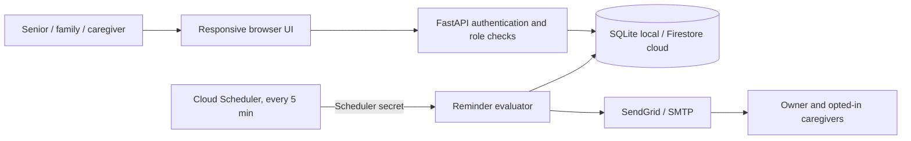

# CareCircle — Smart Elderly Care & Medication Management

**Hack2Skill Promptwars × Catalyst | Elderly Care & Medication Management Platform**

CareCircle is an elderly-first care coordination web app. It tracks daily medication schedules and appointments, invites trusted family members via single-use passcodes, records medication confirmations, provides an accessible read-aloud briefing, generates actionable adherence insights, and sends scheduled email reminders when an email provider is configured.

> **Scope:** Hackathon MVP, **not a certified medical device**. It never prescribes, diagnoses, automatically confirms a medication, or instructs someone to double a missed dose. Use fictional data for public demonstrations. See [Security & limitations](#security-and-limitations).

## What works in this repository

| Feature | Implementation |
| --- | --- |
| Secure accounts | Email/password auth, strong scrypt password hashes and signed 12-hour bearer sessions |
| Shared care profiles | Owner, family, caregiver and read-only viewer roles; membership enforced on each endpoint |
| Passcode access | Cryptographically random 12-character, one-use invitation, SHA-256 storage, 24-hour expiry; requires signed-in account |
| Elder-centred control | Profile owner controls alerts/access; can transfer ownership to an elderly member who explicitly accepts |
| Daily medications | Add/edit/archive schedules, dosage and instructions, multiple daily times, mark taken/skipped/undo |
| Appointments | Create, edit, cancel, and display upcoming/previous appointments |
| Smart email reminders | Upcoming doses (default 15 min), unconfirmed doses (default 30 min), appointments at 24h/1h |
| Collaborative alerts | Family and caregivers get **unconfirmed**-dose alerts if enabled by the owner |
| Accessibility | Responsive design, accessible labels, large-text toggle, browser speech-synthesis day briefing |
| Insights | Seven-day adherence metrics, daily chart, honest rule-based check-in suggestions |
| Activity & export | Audit trail, reminder delivery status, seven-day CSV of confirmations |
| Persistence | Local SQLite; managed Google Cloud Firestore on Cloud Run |
| Testing | API integration tests for permissions, invite redemption, ownership transfer, reminders and repeat suppression |

### Stack

**FastAPI (Python)** + vanilla **HTML/CSS/JavaScript**, SQLite for local development, Firestore for Cloud Run, SendGrid/SMTP email, Google Cloud Scheduler for cron, Dockerfile for Cloud Run. No frontend build step, API keys in frontend, or external JavaScript libraries.

## Launch locally — easiest method

Python 3.11+ recommended. In a terminal inside the extracted `carecircle-ai` folder:

```bash
python -m venv .venv
# Windows PowerShell:
.venv\Scripts\Activate.ps1
# macOS/Linux: source .venv/bin/activate
pip install -r requirements.txt
```

**Windows PowerShell:**

```powershell
$env:DEMO_MODE="1"
$env:APP_ENV="development"
$env:APP_SECRET="local-only-random-secret-12345678901234"
uvicorn app.main:app --reload --port 8000
```

**macOS/Linux:**

```bash
DEMO_MODE=1 APP_SECRET=local-only-random-secret-12345678901234 uvicorn app.main:app --reload --port 8000
```

Open **http://localhost:8000**. Press **Try demo account**, or sign in with:

```
Email:    demo@carecircle.app
Password: Demo@12345
```

This seeds **fictional** Meera Sharma, example prescriptions (not medical guidance), a chart with example historical confirmations, and sample appointments. `DEMO_MODE=1` also enables the **Preview alert** button; it creates a simulated notification without emailing anyone. You can instead sign up for your own account and create a new profile.

### Demo workflow for judging

1. Sign in to the demo; show the overview, seven-day adherence chart, and **Read my day** voice briefing.
2. Open **Medications**, add a medicine and its daily times, then mark a dose **Taken**.
3. Open **Appointments** and add a future visit.
4. Open **Care circle**, choose **Invite someone** and select `family`, `caregiver`, or `viewer`; show the one-use invitation code. In a separate browser session, sign up as a second user and redeem the code.
5. Show that a `viewer` can read but cannot edit, then discuss the **Transfer ownership** flow that requires explicit acceptance.
6. Open **Activity** and press **Preview alert**. Demonstrate a non-delivered alert record, then explain that configured Cloud Scheduler + SendGrid produces actual emails.
7. Open **Settings** and change the reminder lead time, escalation grace period, and caregiver notification opt-in.

## Submit to Hack2Skill

Open **[SUBMISSION_CHECKLIST.md](SUBMISSION_CHECKLIST.md)** for the GitHub → Cloud Run → LinkedIn → Hack2Skill submission sequence.

## Deploy on Google Cloud Run

See **[DEPLOY.md](DEPLOY.md)** for a tested-command-style Cloud Shell walkthrough, including Firestore, the service account, Secret Manager and a Cloud Scheduler job. The included executable script is `scripts/deploy_cloud_run.sh`.

The Cloud Run URL belongs to **your own Google Cloud project**, so the repository cannot include a real URL before you deploy it. Cloud Run needs Firestore because its container filesystem is ephemeral; do not select SQLite for a real deployment.

## Scheduled reminders & email

Cloud Scheduler invokes `POST /api/scheduler/run` every 5 minutes with a protected `X-Scheduler-Key` header. Each medication occurrence is keyed by medication ID + local date + local HH:MM, so alert attempts are deduplicated per recipient. Reminders reference the care profile's time zone.

- **Upcoming** medication reminders go to the profile owner's account email.
- **Unconfirmed dose** check-in alerts go to opted-in family/caregiver account emails if the owner enables notifications.
- **Appointments** send owner and caregiver reminders around 24h and 1h beforehand.
- A **taken or skipped** dose stops upcoming and unconfirmed reminders for that occurrence. Unconfirmed means no recorded confirmation, **not** that a dose was medically missed.
- With **no SendGrid or SMTP credentials**, all reminder attempts are saved as `demo` in Activity, and **no external email is sent**. With a configured provider, status is `sent` or `failed`.

Email is not guaranteed to reach recipients without a verified sender, operational Scheduler, mail provider and network access. Cloud Run jobs running more than once and delayed executions should be monitored in production.

## Run tests

```bash
pip install -r requirements-dev.txt
pytest -q
node --check app/static/app.js
```

These include API integration tests. **Browser screenshot tests were not executed in the build environment** because its Chromium networking is restricted; test in a local browser before final hackathon submission.

## Architecture



## Security and limitations

- User-generated display values are HTML-escaped; access control is checked for each patient resource. Strong scrypt hashes protect stored passwords; passcodes are stored as digests and never reused.
- Invite codes authenticate a **membership invitation**, not a login; a unique authenticated account is still required. The owner decides roles, can revoke access, and can initiate a consensual ownership transfer.
- Auth tokens are stored in the browser's **sessionStorage** (cleared when the tab session closes); APIs require bearer auth. Credentials and secrets remain server-side.
- Configuring real email and processing personal health data requires consent, a privacy policy and suitable safeguards for your jurisdiction. Never use the sample demo account for real patient information.
- Production hardening still required before real-world clinical use: distributed login rate limits, email verification, reset flows, retention/deletion policies, alert delivery queues, token revocation, monitoring, access audits, Firestore backup strategy, provider compliance assessment, threat modeling and appropriate healthcare/regulatory review.
- This MVP uses a single-worker scheduled scan over patients. For many profiles, migrate to indexed due-event tasks with Cloud Tasks and transactionally leased notification workers.
- The **care insight** is transparently rule-based and the read-aloud feature uses browser text-to-speech; the app does **not** claim to have a generative AI model, prescription OCR, or medical decision support.

## Files

```
app/main.py           FastAPI routes, validation, role checks, audit logging
app/store.py          SQLite / Firestore adapters
app/security.py       Password hashing, signed sessions, invite-code crypto
app/alerts.py         Scheduled reminder logic and email providers
app/static/           Responsive browser interface, no build step
scripts/              Deploy helper script
DEPLOY.md             Cloud Run + Firestore + email + Scheduler setup
DEMO_SCRIPT.md        Recommended hackathon demonstration
LINKEDIN_POST.md      Ready-to-edit post copy
JUDGING_NOTES.md      Evaluation-criteria mapping
tests/                API tests
Dockerfile            Cloud Run container image
```

## License

MIT license. This is sample software; no warranties of medical fitness or clinical safety.
